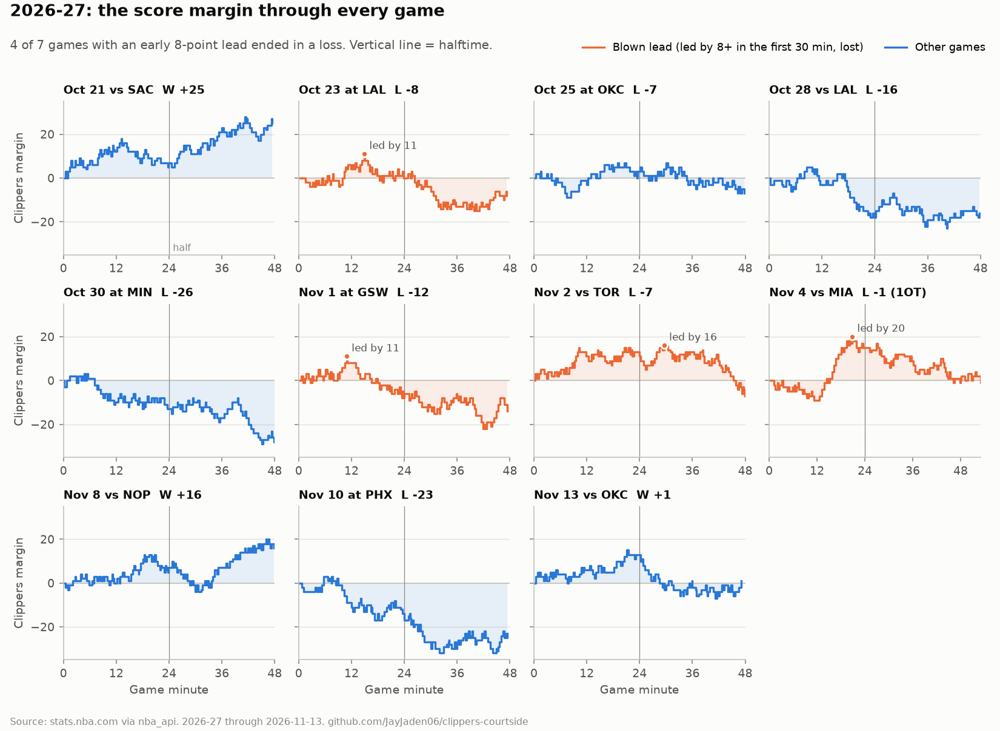
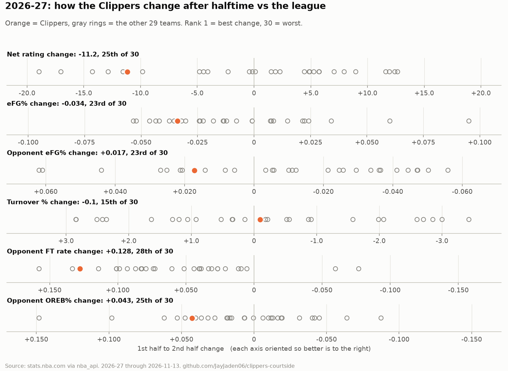
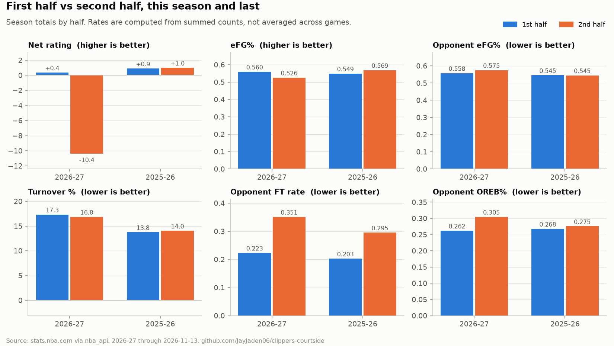
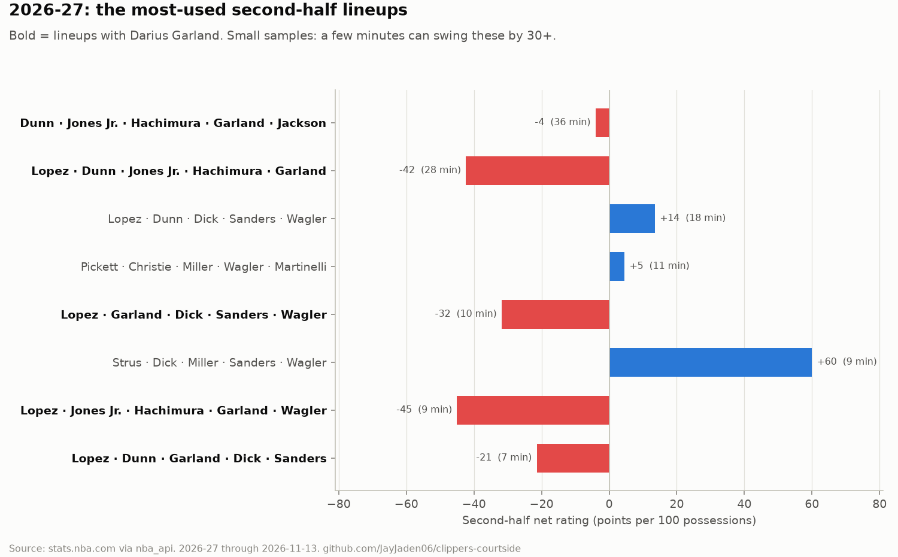
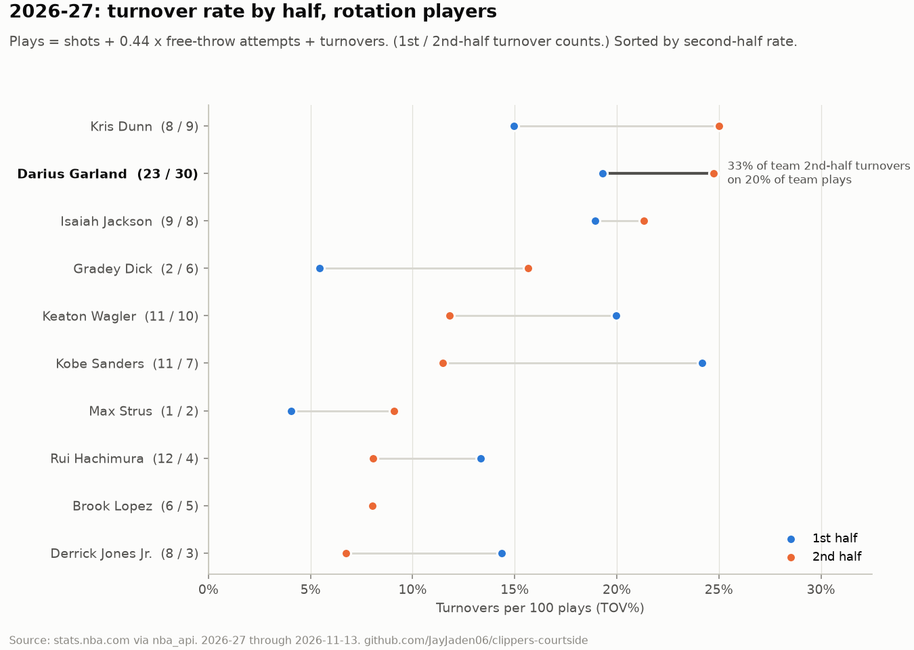
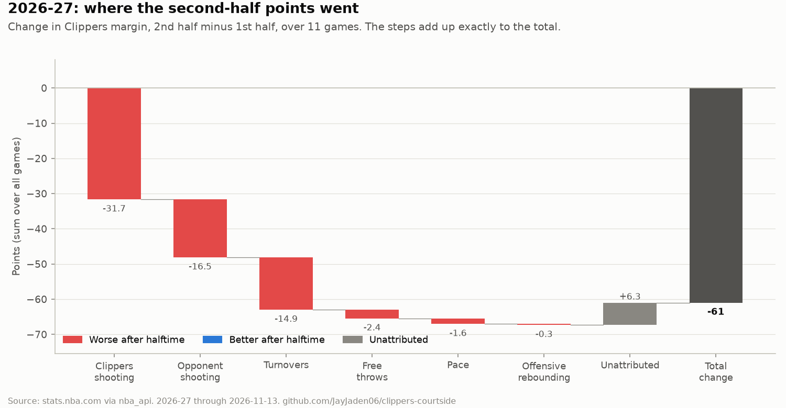
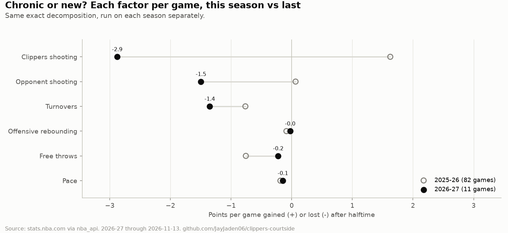

# Why the Clippers lose leads after halftime (2026-27)

*11 games, data through 2026-11-13, compared with 2025-26. Generated by `courtside report` from `data/processed/`. Don't edit by hand: rerun it.*

## Executive summary

Through 11 games of 2026-27, the Clippers are +0.4 per 100 possessions in first halves and -10.4 in second halves, a drop that ranks 25th of 30, and they have lost 4 of the 7 games in which they led by 8+ early (last season: 16 of 47). The biggest factor is their own shooting: eFG% falls from 0.560 to 0.526 after halftime, the 8th-largest drop, worth -32 of the -61-point swing. It is not mainly Darius Garland. He is the team's biggest single source of second-half turnovers (33% of them on 20% of the team's plays), but even against the most generous baseline his excess turnovers are worth about 20 points, 33% of the swing; the team's large second-half on/off gap with him is mostly on defense. As a team they turn it over about as often after halftime (99 vs 96); what changes is the cost (110 vs 149 opponent points off them), and the turnover factor contributes to the swing (24%). Fouling is a minor part of it (4%) and is about the same as last season; most of the second-half jump in opponent free throws comes from late fouling by a team already behind and one outlier game. Compared with last season, what is new is Clippers shooting and opponent shooting; what is chronic is turnovers. 11 games is a small sample: the 90% interval for the net-rating drop (-26.7 to +5.4) includes zero, so treat these as leads to keep checking, not settled rates.

**Charts to look at first:**

1. [`attribution.png`](figures/attribution.png): where the second-half points went; the whole answer in one picture
2. [`player_tov_by_half.png`](figures/player_tov_by_half.png): the Garland question: his turnover rate next to everyone else's
3. [`margin_small_multiples.png`](figures/margin_small_multiples.png): what the collapses actually looked like, game by game

| | Question | Answer |
|---|---|---|
| H1 | The second-half collapse is real | Not clearly |
| H2 | Turnovers drive it | Contributes (24% of the swing); costlier, not more frequent |
| H3 | It's Darius Garland specifically | Partly (33% of the swing) |
| H4 | Fouls and free throws drive it | Minor (4% of the swing) |
| H5 | It's shooting regression, not turnovers | Mostly yes, but it is the Clippers' shooting, not the opponents' |
| ATTR | Ranked attribution of the 1H -> 2H swing | Largest factor: Clippers shooting (-31.7 of -61) |
| SEASONS | 2026-27 vs 2025-26: chronic or new? | New: Clippers shooting and opponent shooting. Chronic: turnovers |

## H1. The second-half collapse is real

**Answer: Not clearly.**

Not clearly: net rating goes from +0.4 in first halves to -10.4 in second halves, a change of -11.2 per 100 possessions. That ranks 25th of 30 (league average change -0.1, so most teams barely move), and second halves were worse in 6 of 11 games. Some of it is regression: first-half eFG% was 0.560 (8th in the league, +0.021 vs the league's first-half average). But the second half (0.526, 17th) is -0.005 below the league's second-half average, so the drop overshoots a return to normal. Opponents, if anything, were hot early (0.558 first-half eFG% vs a league average of 0.539; 3P% 0.367) and cooled off after halftime, which helped the Clippers rather than hurt them. Sample: 11 games (22 halves), so treat every number here as a lead, not a settled rate. The 90% bootstrap interval for the net-rating change (resampling games) is -26.7 to +5.4, which includes zero: relative to the league it looks real, but 8 games cannot rule out noise.

`h1_halves.csv`

| metric | H1 | H2 | change |
|---|---|---|---|
| Net rating | 0.4 | -10.4 | -10.7 |
| Offensive rating | 111.2 | 110.4 | -0.8 |
| Defensive rating | 110.9 | 120.8 | 9.9 |
| eFG% | 0.560 | 0.526 | -0.034 |
| 3P% | 0.420 | 0.346 | -0.074 |
| Opponent eFG% | 0.558 | 0.575 | 0.017 |
| Opponent 3P% | 0.367 | 0.367 | -0.001 |

`h1_regression.csv`

| half | clippers_efg | league_avg_efg | clippers_minus_league | clippers_prior_season_efg |
|---|---|---|---|---|
| H1 | 0.560 | 0.539 | 0.021 | 0.549 |
| H2 | 0.526 | 0.531 | -0.005 | 0.569 |

## H2. Turnovers drive it

**Answer: Contributes (24% of the swing); costlier, not more frequent.**

The turnover factor contributes to the collapse, but not in the way it looks. The Clippers turn it over about as often after halftime (99 vs 96 turnovers including team turnovers; TOV% 28th and 26th of 30 in the two halves, so the rate is a whole-game problem, 15th on the change). What changes is the cost: opponents score 110 points off them in first halves and 149 in second halves (1.11 vs 1.55 per turnover), with live-ball share 48% -> 53% and opponent fast-break points 69 -> 104. In the exact decomposition, lost shots from turnovers account for -14.9 of the -61-point swing (24%); the extra transition scoring shows up inside opponent shooting, which overall got *worse* after halftime. Across games, second-half points off turnovers and second-half margin correlate at r = -0.43, and the change in turnovers vs the change in margin at r = -0.44 (n = 11). Sample: 11 games (22 halves), so treat every number here as a lead, not a settled rate.

`h2_totals.csv`

| metric | H1 | H2 |
|---|---|---|
| Turnovers (incl. team) | 99 | 96 |
| Live-ball share | 0.485 | 0.531 |
| Opponent points off turnovers (official) | 110 | 149 |
| Opponent points per turnover | 1.1 | 1.6 |
| Opponent fast-break points | 69 | 104 |
| TOV% (league rank) | 17.7 (28) | 17.6 (26) |

`h2_by_lead_class.csv`

| lead_class | tov_h2 | opp_pts_off_tov_h2 | margin_h2 | games |
|---|---|---|---|---|
| blown_lead | 10.0 | 15.0 | -11.8 | 4 |
| held_lead | 6.3 | 10.3 | 5.0 | 3 |
| never_led_big | 9.2 | 14.5 | -6.8 | 4 |

## H3. It's Darius Garland specifically

**Answer: Partly (33% of the swing).**

Partly: Darius Garland is the team's biggest single source of second-half turnovers, but not the main reason for the collapse. He has 30 of the team's 92 second-half player turnovers (33%) on 20% of the team's shots, free-throw trips and turnovers, and his TOV% rises from 19.3% to 24.7% (2nd highest of 11 rotation players after halftime); 53% of them are live-ball. Last season his second-half TOV% was 15.0% (Cleveland and Clippers combined). Measured against whichever baseline gives the hypothesis the most credit, his excess second-half turnovers number about 13.9 over 11 games, worth roughly 20 points at 1.45 points per turnover - 33% of the -61-point swing. The team's second-half on/off with him is large (-43.0 net rating, 172 minutes on vs 92 off), but the team's turnover rate is similar either way (18.2 vs 16.2 per 100); the gap is mostly defense (ORtg -11.4, DRtg +31.6 on vs off; part of that is transition defense after his live-ball turnovers). In the 92 second-half minutes he sat, the team was better (+17.3), but that is a few dozen possessions and reflects who replaced him and when. Sample: 11 games (22 halves), so treat every number here as a lead, not a settled rate.

`h3_baselines.csv`

| season | team | split | games | minutes | tov | tov_pct | live_share |
|---|---|---|---|---|---|---|---|
| 2025-26 | CLE | H1 | 26 | 413.5 | 30 | 0.118 |  |
| 2025-26 | CLE | H2 | 26 | 373.5 | 42 | 0.185 |  |
| 2025-26 | LAC | H1 | 19 | 294.8 | 39 | 0.199 | 0.590 |
| 2025-26 | LAC | H2 | 19 | 255.3 | 18 | 0.104 | 0.722 |
| 2026-27 | LAC | H1 | 11 | 186.2 | 23 | 0.193 | 0.565 |
| 2026-27 | LAC | H2 | 11 | 171.9 | 30 | 0.247 | 0.533 |

`h3_onoff_h2.csv`

| metric | on | off | on_minus_off |
|---|---|---|---|
| Minutes | 171.9 | 92.1 | 79.7 |
| Net rating | -25.7 | 17.3 | -43.0 |
| Offensive rating | 105.9 | 117.3 | -11.4 |
| Defensive rating | 131.6 | 100.0 | 31.6 |
| Team TOV% | 18.2 | 16.2 | 1.9 |
| Team fouls per 100 | 26.3 | 23.0 | 3.2 |

## H4. Fouls and free throws drive it

**Answer: Minor (4% of the swing).**

Fouling is a minor part of the collapse on the scoreboard, and it is a chronic habit rather than a new one. Team fouls go from 86 to 127 and opponent free-throw rate from 0.223 to 0.351 (change ranked 28th of 30; last season 28th). But 17 of the second-half fouls were late fouls by a team already behind (32 opponent FTA) - a consequence of losing, not a cause. Without those and without the TOR game, the rise is +0.031, close to last season's +0.068 (same adjustments). The Clippers also get to the line more after halftime (99 -> 115 made), so in the decomposition free throws net -2.4 points of the -61 (4%), -0.2 per game vs -0.8 per game last season. Sample: 11 games (22 halves), so treat every number here as a lead, not a settled rate.

`h4_totals.csv`

| metric | H1 | H2 |
|---|---|---|
| Team fouls | 86 | 127 |
| Late fouls while trailing | 0 | 17 |
| Opponent FTA | 108 | 166 |
| Opponent FTA from late fouls | 0 | 32 |
| Opponent FT rate | 0.223 | 0.351 |
| Opponent FT rate excl. late fouls | 0.223 | 0.283 |
| Opponent FT rate excl. late fouls and TOR | 0.226 | 0.257 |
| Opponent FTM | 81 | 118 |
| Clippers FTM | 99 | 115 |
| Minutes opponent in bonus | 48.9 | 80.4 |

`h4_foulers_h2.csv`

| player_name | pf | fouls_shooting | fouls_late_trailing | minutes | pf_per36 |
|---|---|---|---|---|---|
| Brook Lopez | 22 | 13 | 1 | 124.9 | 6.3 |
| Isaiah Jackson | 15 | 3 | 0 | 88.8 | 6.1 |
| Keaton Wagler | 14 | 6 | 1 | 143.7 | 3.5 |
| Darius Garland | 13 | 4 | 2 | 171.9 | 2.7 |
| Gradey Dick | 12 | 8 | 0 | 89.2 | 4.8 |
| Kris Dunn | 11 | 2 | 3 | 136.1 | 2.9 |
| Max Strus | 11 | 3 | 5 | 57.8 | 6.8 |
| Derrick Jones Jr. | 10 | 6 | 0 | 122.1 | 2.9 |

## H5. It's shooting regression, not turnovers

**Answer: Mostly yes, but it is the Clippers' shooting, not the opponents'.**

Mostly yes, but it is the Clippers' shooting, not the opponents'. Clippers eFG% falls from 0.560 to 0.526 (-0.034; 90% interval -0.094 to +0.020), the 8th-largest drop in the league, and 3P% from 0.420 to 0.346. Opponents shoot better after halftime (0.558 -> 0.575; interval -0.042 to +0.076), so the answer to 'do opponents just shoot better after halftime?' is yes. In the decomposition, Clippers shooting accounts for -31.7 of the -61-point swing; the other factors roughly cancel (opponent shooting -16.5, turnovers -14.9, rebounding -0.3, free throws -2.4, unattributed +6.3). Offensive rebounds allowed rise (0.262 -> 0.305, change ranked 25th), worth -0.3 points net; pace barely moves (101.8 -> 99.5). Last season the same shooting factor was +1.6 points per game; this season it is -2.9. Sample: 11 games (22 halves), so treat every number here as a lead, not a settled rate.

`h5_shooting.csv`

| metric | H1 | H2 | change |
|---|---|---|---|
| eFG% | 0.560 | 0.526 | -0.034 |
| 3P% | 0.420 | 0.346 | -0.074 |
| FG% | 0.470 | 0.448 | -0.022 |
| Opponent eFG% | 0.558 | 0.575 | 0.017 |
| Opponent 3P% | 0.367 | 0.367 | -0.001 |
| OREB% | 0.240 | 0.261 | 0.021 |
| Opponent OREB% | 0.262 | 0.305 | 0.043 |
| Pace | 101.8 | 99.5 | -2.4 |
| 3PA share of FGA | 0.427 | 0.448 | 0.021 |
| Paint points | 248 | 248 | 0 |

## ATTR. Ranked attribution of the 1H -> 2H swing

**Answer: Largest factor: Clippers shooting (-31.7 of -61).**

Of the -61-point first-to-second-half swing across 11 games, the largest factor is Clippers shooting (eFG%) (-31.7, -2.9 per game), then Opponent shooting (eFG%) (-16.5). Factors can offset: a positive number means that factor got better after halftime. In the 3 games lost after leading at the half (OKC, TOR, MIA), the most costly factors were OKC: Opponent shooting (eFG%) (-13.9 of -13); TOR: Turnovers (shots lost / gained) (-11.0 of -29); MIA: Clippers shooting (eFG%) (-25.6 of -30). This is a description of where the points went, not a causal estimate.

`attribution.csv`

| label | points | per_game | share_of_swing |
|---|---|---|---|
| Clippers shooting (eFG%) | -31.7 | -2.9 | 0.519 |
| Opponent shooting (eFG%) | -16.5 | -1.5 | 0.270 |
| Turnovers (shots lost / gained) | -14.9 | -1.4 | 0.244 |
| Unattributed (possession-accounting residual) | 6.3 | 0.6 | -0.104 |
| Free throws (made FTs, net of trips) | -2.4 | -0.2 | 0.040 |
| Pace (possessions) | -1.6 | -0.1 | 0.026 |
| Offensive rebounding | -0.3 | -0.0 | 0.005 |

`attribution_per_game.csv`

| game_date | opponent_abbreviation | halftime_margin | final_margin | margin_change | shooting | opp_shooting | turnovers | rebounding | free_throws | pace | residual |
|---|---|---|---|---|---|---|---|---|---|---|---|
| 2026-10-21 | SAC | 7 | 25 | 11 | 0.4 | 8.9 | 0.9 | -2.2 | 3.7 | -2.1 | 1.2 |
| 2026-10-23 | LAL | 0 | -8 | -8 | -13.2 | -3.3 | 1.7 | 0.9 | 3.6 | -1.5 | 3.9 |
| 2026-10-25 | OKC | 3 | -7 | -13 | -0.9 | -13.9 | -2.7 | 5.6 | -7.1 | -2.7 | 8.7 |
| 2026-10-28 | LAL | -18 | -16 | 20 | 7.4 | 4.0 | 6.0 | -2.7 | 1.5 | -0.8 | 4.6 |
| 2026-10-30 | MIN | -13 | -26 | 0 | -13.1 | 15.3 | -8.3 | 0.3 | 3.9 | -1.6 | 3.5 |
| 2026-11-01 | GSW | -6 | -12 | 0 | -0.8 | -4.0 | 6.6 | -2.8 | 2.6 | 0.1 | -1.8 |
| 2026-11-02 | TOR | 11 | -7 | -29 | -1.8 | 0.9 | -11.0 | -5.7 | -7.9 | 0.9 | -4.4 |
| 2026-11-04 | MIA | 15 | -1 | -30 | -25.6 | 10.8 | -3.6 | -4.2 | -6.8 | 0.8 | -1.4 |
| 2026-11-08 | NOP | 7 | 16 | 2 | 5.2 | -10.6 | -4.4 | 8.4 | 8.1 | -1.3 | -3.4 |
| 2026-11-10 | PHX | -17 | -23 | 11 | 5.0 | -6.2 | 9.2 | 2.7 | 3.8 | 0.0 | -3.5 |
| 2026-11-13 | OKC | 13 | 1 | -25 | 8.2 | -20.9 | -6.2 | 1.0 | -6.8 | 0.9 | -1.1 |

## SEASONS. 2026-27 vs 2025-26: chronic or new?

**Answer: New: Clippers shooting and opponent shooting. Chronic: turnovers.**

Last season the Clippers were essentially even after halftime (+0.5 per game in first halves, +0.4 in second halves) and blew 16 of 47 eight-point leads (34%). This season it is +0.2 and -5.4, with 4 of 7 leads blown. New this season (at least 1 point per game worse than last season): Clippers shooting (eFG%), Opponent shooting (eFG%). Chronic (costing at least half a point per game in both seasons): Turnovers (shots lost / gained). Sample: 11 games (22 halves), so treat every number here as a lead, not a settled rate.

`season_comparison.csv`

| season | games | margin_h1_per_game | margin_h2_per_game | net_h1 | net_h2 | efg_h1 | efg_h2 | tov_pct_h1 | tov_pct_h2 | opp_ft_rate_h1 | opp_ft_rate_h2 | blown_leads | held_leads | shooting_per_game | opp_shooting_per_game | turnovers_per_game | rebounding_per_game | free_throws_per_game | pace_per_game | residual_per_game |
|---|---|---|---|---|---|---|---|---|---|---|---|---|---|---|---|---|---|---|---|---|
| 2026-27 | 11 | 0.182 | -5.4 | 0.357 | -10.4 | 0.560 | 0.526 | 17.3 | 16.8 | 0.223 | 0.351 | 4 | 3 | -2.9 | -1.497 | -1.352 | -0.026 | -0.223 | -0.146 | 0.575 |
| 2025-26 | 82 | 0.524 | 0.4 | 0.894 | 1.0 | 0.549 | 0.569 | 13.8 | 14.0 | 0.203 | 0.295 | 16 | 31 | 1.6 | 0.064 | -0.764 | -0.087 | -0.756 | -0.186 | -0.017 |

## Methodology

- **Data.** Every 2026-27 and 2025-26 Clippers regular-season game from stats.nba.com via `nba_api`: game logs, box scores filtered to each half (`BoxScoreTraditionalV3`, `AdvancedV3`, `MiscV3`), play-by-play, on/off and lineup dashboards by period, and league-wide team dashboards by period for ranks. 2026-27 data through 2026-11-13; analyzed on 2026-11-14.
- **Halves.** Period filters on the V3 box-score endpoints are only honoured with `range_type=1`; without it they silently return the full game. Every pull checks that H1 + H2 (+ OT) equals the full-game box score, that play-by-play final scores match, and that the halftime margin from play-by-play matches the H1 box score. Overtime is kept separate and excluded from 1H vs 2H comparisons.
- **Rates.** All rates (eFG%, TOV%, FT rate, ratings) are recomputed from summed counts, never averaged across games. Possessions follow the NBA's box-score estimate.
- **Attribution.** Points = 2 x eFG% x FGA + FTM for each side, and the change from first to second half is split exactly with the midpoint rule; shot volume is then split with FGA = possessions + OREB - TOV - free-throw trips. The factors sum exactly to the change in margin. What can't be placed is reported as "unattributed" rather than folded into another factor. It describes where the points went, not why.
- **Garland.** His excess second-half turnovers are measured against whichever baseline gives the hypothesis the most credit (his own first halves, his 2025-26 second halves), and valued at what a second-half turnover costs: the Clippers' points per possession given up, plus how much more opponents score off a turnover than off an average possession. A test triples his second-half turnovers and checks that the verdict flips to "Yes".
- **Thresholds** (set before reading the results): a factor *drives* the swing at 40% or more, *contributes* at 15%-40%, and is *minor* below 15%; a 1H to 2H change ranked 26th-30th is "among the worst"; an early lead is 8+ points in the first 30 minutes.
- **Uncertainty.** 90% intervals come from resampling whole games 4,000 times.

## Limitations

- **Sample size.** 11 games is 22 halves. Several verdicts could flip with a few more games, which is why every number is rerun from scratch on each pull.
- **Points off turnovers.** Totals come from the official per-half `BoxScoreMiscV3` counts. The live-ball vs dead-ball split comes from play-by-play, and the play-by-play estimate matches the official count in 95% of game-halves.
- **Unattributed points.** This season's residual is mostly Clippers second-half shots that the possession identity can't place, most likely team offensive rebounds that the box score doesn't count.
- **On/off and lineups** are small samples dominated by who was on the floor in which games. They describe, they don't isolate.
- **Garland's 2025-26** combines his Cleveland and Clippers games. His Cleveland halves are his season dashboard minus his Clippers box scores, checked against his game log.

Full result tables: `data/processed/analysis/`. Key numbers and verdicts: `reports/analysis.json`.
